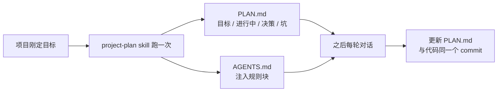

# project-plan

> One-shot Codex skill: bootstrap a `PLAN.md`, inject always-on rules into your repo's `AGENTS.md`, then get out of the way.

一次性脚手架：项目建立时装一次，之后靠项目里的 `AGENTS.md` + `PLAN.md` 运转，**不再调用 skill**。

`git log` 记改了什么，`PLAN.md` 记目标、为什么、下一步和坑。

## 它解决什么

- **换对话就失忆**：新开一个会话，模型不知道做到哪了。
- **计划漂移**：没有一个稳定的地方写“为什么这么定”，每次都要重新解释。
- **规则常驻**：要么每轮都靠模型想起来调用 skill，要么把规则写进项目里。

答案是后者：规则只写一次，存进仓库，跟着代码一起版本化。

## 机制



只有两个东西留在项目里：`PLAN.md` 和 `AGENTS.md` 里的标记块。没有守护进程、没有配置、没有额外依赖。

## 快速开始

**1. 安装 skill**

```powershell
git clone https://github.com/LDPlong/project-plan.git
cd project-plan
powershell -File scripts/install.ps1
```

安装到 `~/.codex/skills/project-plan`，或者手动复制 `skills/project-plan/` 到你的 skills 目录。

**2. 每个新项目用一次**

项目刚定目标时，对这个项目说：

```text
用 project-plan 初始化这个项目的计划清单
```

skill 会：写 `PLAN.md`（目标 / 验收标准 / 非目标 / 任务）→ 把规则块注入仓库 `AGENTS.md`（带 begin/end 标记，可重复执行）→ 自查章节、「进行中」数量、总行数。

**3. 之后什么都不用做**

任务开始前读清单、完成后更新、记录决策和坑，全部由 `AGENTS.md` 里的规则负责。

## 仓库结构

```
skills/project-plan/SKILL.md                     脚手架流程（只在建项目时用）
skills/project-plan/references/PLAN-template.md  清单模板
skills/project-plan/references/AGENTS-block.md   注入 AGENTS.md 的规则块
scripts/check-plan.ps1                           可选自检工具
scripts/install.ps1                              安装到 ~/.codex/skills
AGENTS.md                                        本仓库自己的规则（含注入块，dogfooding）
PLAN.md                                          本仓库自己的清单
```

## 可选：清单自检

```powershell
powershell -File scripts/check-plan.ps1 -Path PLAN.md
```

检查四项：必备章节齐全、「目标」非空、「进行中」≤1 条、有效行数 ≤50。CI 里也会跑一次（见 `.github/workflows/plan-check.yml`）。

## 设计取舍

- **状态放文件，不放模型记忆**：新对话读文件是唯一可靠的恢复方式。
- **触发靠 `AGENTS.md`，不靠 skill**：常驻指令比按需匹配可靠；skill 只在初始化时用一次。
- **注入块必须自包含**：不能引用 skill 里的内容，否则未来对话读不到。
- **只记 git 记不住的**：目标、理由、坑、下一步；代码改动一律不抄。
- **一份 `PLAN.md` 只放项目根目录**，50 行封顶，超了就归档旧里程碑。
- **全局只留一行兜底**：可在 `~/.codex/AGENTS.md` 加一句“存在 PLAN.md 就先读”，覆盖没初始化的存量仓库；完整协议仍只在项目块里。

## 兼容性

- Codex（桌面端 / CLI），依赖 `AGENTS.md` 机制。
- 脚本需要 PowerShell 5.1+ 或 PowerShell 7+；CI 使用 GitHub Actions 的 `pwsh`。
- 清单是纯 Markdown，git 之外的场景也能用。

## License

MIT